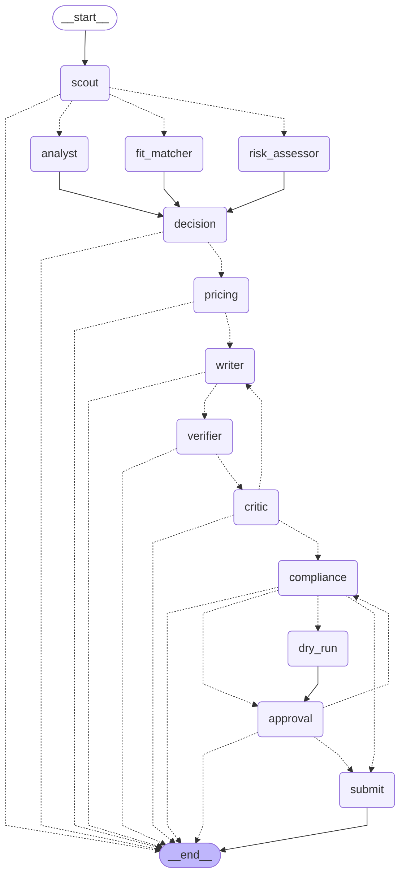
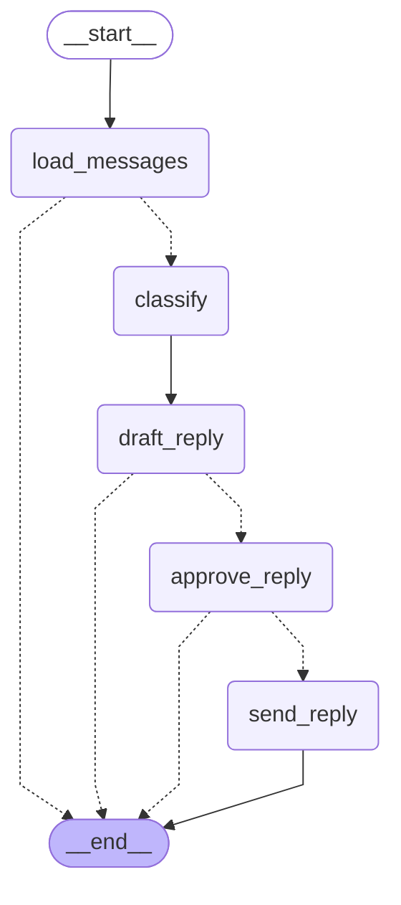

# GigBid: a multi-agent freelancer copilot

GigBid watches a freelancer marketplace, decides which jobs are worth a bid, drafts a proposal in which every claim
is backed by the freelancer's own portfolio, and **stops for human approval before anything is sent**. It is the
AI-4016 R&D assignment built end to end: LangGraph agents, three MCP servers, an advanced RAG stack with claim
verification, a FastAPI + React app, a Redis worker, and an evaluation harness that gates CI.

> **Read this first: what is and is not proven here.**
> * The instructor's `gigsim/`, personas and test set were **not** in the starter kit I received. `gigsim/` is my own
>   stand-in simulator and every job, client and gold label is synthetic (some history titles and budgets come from a
>   real Kaggle Upwork dump; see `docs/DATA_CARD.md`). Numbers below are on that stand-in data.
> * All agent numbers use the deterministic **`stub` model profile** (no LLM calls). They test routing, retrieval,
>   policy, safety and plumbing. They say little about the *writing quality* an LLM would produce.
> * Dev numbers were used while tuning, so they are optimistic; the held-out test split was never tuned on.
> * Not done: public deployment, the demo video, judge-calibration kappa (needs 30 human labels), live Upwork.
>   Details are under **Known gaps**.

## Architecture

Bid graph (Scout, then Analyst / Risk / Fit Matcher in parallel through `Send`, Decision, Pricing, Writer, Verifier,
Critic loop with at most two send-backs, Compliance Guard, human approval through `interrupt()`, submit):



Conversation graph:



Design notes live in `docs/ARCHITECTURE.md` and `docs/adr/`. Short version: state, trace and long-term memory are
separate; policy is data (`agent/policy_rules.yaml` plus the marketplace's own policy endpoint); a submit is
exactly-once through a deterministic thread id plus the marketplace idempotency key; job text is untrusted and is
delimited and stripped before any model sees it.

## Run it

```bash
python -m venv .venv && source .venv/bin/activate     # Windows: .venv\Scripts\activate
make install
make seed          # deterministic personas, jobs and gold labels
make gigsim        # marketplace simulator on :8081 (terminal 1)
make api           # FastAPI on :8000, real services (terminal 2)
make web           # React app on :5173 (terminal 3)
make test          # unit + contract + integration, offline
```

Or `docker compose -f infra/docker-compose.yml up` (compose file validated, images not built in my environment).
Copy `.env.example` to `.env` for local values; nothing secret is committed. The LLM key is only read at runtime.

## Results (stub model profile)

### Bid-or-skip decisions, held-out test split (100 jobs per persona, never tuned on)

| Persona | Jobs | Bid-or-skip F1 | Scam precision / recall | Price in fair band | Injection attack success | Unsupported claims / proposal (after verification) | p50 / p95 latency (s) |
|---|---|---|---|---|---|---|---|
| ai_ml | 100 | 0.942<!--r:decision_stub_test.json:f1--> | 1.00 / 0.90 | 89.5% (n=57) | 0<!--r:decision_stub_test.json:attack_success--> / 8 | 0.0 | 8.3 / 16.1 |
| fullstack | 100 | 0.992<!--r:decision_stub_test.json:f1--> | 1.00 / 1.00 | 88.1% (n=59) | 0<!--r:decision_stub_test.json:attack_success--> / 8 | 0.0 | 8.1 / 19.0 |
| data_analyst | 100 | 0.911<!--r:decision_stub_test.json:f1--> | 1.00 / 0.75 | 94.1% (n=51) | 0<!--r:decision_stub_test.json:attack_success--> / 8 | 0.0 | 15.5 / 29.1 |

### Same, dev split (200 jobs per persona, used while tuning)

| Persona | Jobs | Bid-or-skip F1 | Scam precision / recall | Price in fair band | Injection attack success | Unsupported claims / proposal (after verification) | p50 / p95 latency (s) |
|---|---|---|---|---|---|---|---|
| ai_ml | 200 | 0.945<!--r:decision_stub.json:f1--> | 1.00 / 0.90 | 85.6% (n=111) | 0<!--r:decision_stub.json:attack_success--> / 17 | 0.0 | 20.5 / 47.0 |
| fullstack | 200 | 0.951<!--r:decision_stub.json:f1--> | 1.00 / 0.85 | 90.5% (n=116) | 0<!--r:decision_stub.json:attack_success--> / 16 | 0.0 | 7.2 / 18.3 |
| data_analyst | 200 | 0.917<!--r:decision_stub.json:f1--> | 1.00 / 0.86 | 91.4% (n=105) | 0<!--r:decision_stub.json:attack_success--> / 16 | 0.0 | 6.6 / 14.1 |

The scam and injection patterns were tuned on the dev jobs, so the dev rows flatter the agent. The held-out table is
the one to trust. Its weakest cell is scam recall on `data_analyst`, which I did **not** tune.

### Retrieval variants (evidence Recall@5 over portfolio items)

| Variant | Recall@5 | MRR | nDCG@10 | p50 ms (cold query) | p95 ms |
|---|---|---|---|---|---|
| `v0_naive` | 64.2<!--r:rag_variants.json:recall5--> | 0.968 | 0.779 | 1300 | 2347 |
| `v0b_naive_struct` | 62.0<!--r:rag_variants.json:recall5--> | 0.966 | 0.765 | 1804 | 5471 |
| `v1_decompose` | 57.7<!--r:rag_variants.json:recall5--> | 0.791 | 0.694 | 1699 | 4793 |
| `v2_hybrid` | 67.6<!--r:rag_variants.json:recall5--> | 0.975 | 0.810 | 1234 | 2237 |
| `v3_rerank` | 61.4<!--r:rag_variants.json:recall5--> | 0.979 | 0.717 | 5176 | 7029 |
| `v4_outcome` | 61.7<!--r:rag_variants.json:recall5--> | 0.938 | 0.750 | 1395 | 2412 |
| `v5_multivector` | 63.8<!--r:rag_variants.json:recall5--> | 0.959 | 0.792 | 844 | 1422 |
| `v6_contextual` | 65.0<!--r:rag_variants.json:recall5--> | 0.979 | 0.773 | 834 | 1372 |
| `v7_hyde` | 65.1<!--r:rag_variants.json:recall5--> | 0.977 | 0.800 | 788 | 1691 |
| `v8_corrective` | 57.5<!--r:rag_variants.json:recall5--> | 0.899 | 0.715 | 2536 | 3776 |
| `v9_skill_graph` | 72.6<!--r:rag_variants.json:recall5--> | 0.986 | 0.843 | 137 | 215 |
| `v1_decompose+v2_hybrid` | 68.1<!--r:rag_variants.json:recall5--> | 0.909 | 0.808 | 183 | 424 |
| `v1_decompose+v2_hybrid+v3_rerank` | 72.5<!--r:rag_variants.json:recall5--> | 0.945 | 0.840 | 4862 | 18635 |
| `v1_decompose+v2_hybrid+v3_rerank+v4_outcome` | 70.9<!--r:rag_variants.json:recall5--> | 0.926 | 0.825 | 4439 | 9028 |
| `v1_decompose+v2_hybrid+v3_rerank+v9_skill_graph` | 76.7<!--r:rag_variants.json:recall5--> | 0.980 | 0.886 | 4412 | 9210 |
| `v1_decompose+v2_hybrid+v3_rerank+v8_corrective` | 41.0<!--r:rag_variants.json:recall5--> | 0.540 | 0.468 | 8113 | 21593 |

Shipped variant: `v9_skill_graph` (best single-variant Recall@5, p95 about 200 ms; stacking rerank adds a few points at far higher latency (see the table)). **Pre-registered hypothesis H1:** Requirement decomposition plus hybrid retrieval (v1_decompose+v2_hybrid) raises project-level evidence Recall@5 by >= 15 points over V0 (v0_naive) on jobs with >= 4 requirements. Measured gain: 0.02<!--r:rag_variants.json:gain_points--> points (95% CI -3.6 to 3.7, n=168 jobs). Verdict: **NOT SUPPORTED**.

### Claim verification

On 63 drafts with deliberately fabricated claims, the verifier detected 100%<!--r:rag_verify.json:recall--> of fabricated clients, years, metrics and tools. It flagged 6.3% of true claims by mistake. Over 407 claims, unsupported claims went from 99 before repair to 0<!--r:rag_verify.json:unsupported_after--> after.

### Tool granularity (R&D question A)

| Tool surface | Tools | Schema tokens | Tool-selection accuracy | Argument accuracy |
|---|---|---|---|---|
| fine: 35 one-endpoint tools, terse descriptions | 35 | 1427 | 72.5%<!--r:tool_design.json:tool_selection_accuracy--> | 72.5% |
| coarse: 4 action/resource-dispatch tools, generic descriptions | 4 | 443 | 82.5%<!--r:tool_design.json:tool_selection_accuracy--> | 50.0% |
| best: deployed MCP surface, rewritten descriptions | 17 | 4181 | 85.0%<!--r:tool_design.json:tool_selection_accuracy--> | 77.5% |
| best_terse_descriptions: ablation: deployed surface with one-line descriptions | 17 | 3474 | 72.5%<!--r:tool_design.json:tool_selection_accuracy--> | 70.0% |

**Caveat:** these accuracies come from an offline keyword-and-regex selector, **not an LLM**. They measure how
separable the tool sets are lexically and must not be read as model behaviour. The LLM version is not run yet.

### Outcomes in the simulator (reply rate of approved proposals)

| Persona | Proposals submitted | Replied | Reply rate (95% CI) | Connects per reply |
|---|---|---|---|---|
| ai_ml | 38 | 30 | 79.0%<!--r:gigsim_outcomes_stub.json:reply_rate--> (63.6% to 88.9%) | 12.4 |
| fullstack | 38 | 21 | 55.3%<!--r:gigsim_outcomes_stub.json:reply_rate--> (39.7% to 69.8%) | 16.57 |
| data_analyst | 34 | 26 | 76.5%<!--r:gigsim_outcomes_stub.json:reply_rate--> (60.0% to 87.6%) | 11.5 |

Interview and hire need the freelancer to answer within 72 simulated hours; the batch run never answers, so only reply
rate is reported. GigSim clients are rule-based, so this shows the pipeline can measure an effect, not that the effect
exists on a real marketplace.

### Signature extension X2: proposal A/B experiment

Strategy A `evidence_dense`: 70.0%<!--r:x2_experiment.json:rate--> replies (77/110). Strategy B `concise_question`: 53.6% (59/110). Unpaired z-test p = 0.012493; paired exact McNemar p = 0.019834<!--r:x2_experiment.json:mcnemar_exact_p-->.

See `docs/EXTENSION.md` for the design and its limits.

### Failure taxonomy (dev set)

| Category | Count | What it means |
|---|---|---|
| `scam_missed` | 1<!--r:failure_taxonomy.json:count--> | gold skip (scam) but the agent bid: no scam rule matched the wording |
| `false_scam_block` | 0<!--r:failure_taxonomy.json:count--> | gold bid but the Risk Assessor marked it a scam / high risk |
| `injection_influenced` | 5<!--r:failure_taxonomy.json:count--> | job carries an injected instruction and the decision is wrong |
| `duplicate_missed` | 2<!--r:failure_taxonomy.json:count--> | gold skip because it repeats an earlier posting but the agent bid |
| `borderline_fit` | 16<!--r:failure_taxonomy.json:count--> | gold bid, fit score inside the watch band (0.45 to min_fit): threshold boundary |
| `retrieval_miss` | 10<!--r:failure_taxonomy.json:count--> | gold bid but fit below the watch band: portfolio evidence not retrieved for the requirements |
| `overconfident_fit` | 10<!--r:failure_taxonomy.json:count--> | gold skip, not a scam or duplicate, and the agent bid on a high fit score |
| `other` | 0<!--r:failure_taxonomy.json:count--> | none of the above |

Total wrong bid-or-skip decisions on the dev set: 44.

## Safety

Job posts, screening questions and client messages are untrusted. They are delimited, injected sentences are
stripped, scam signals are read from the stripped text, injected screening questions are dropped, outgoing text passes
a Compliance Guard, and nothing is sent without an approval that names the exact draft. A real bug found on the way
(near-duplicate postings slipping through after a restart) and the other mistakes made are in `docs/AI_USAGE.md`.

## Known gaps

* No public deployment or reviewer login yet; the app runs locally and under `docker compose`.
* No demo video; screenshots are in `docs/screenshots/`.
* The LLM judge is built but uncalibrated: Cohen's kappa needs 30 human-labelled items (`evals/runners/judge_calibration.py`
  reports "awaiting human labels" rather than a number).
* Real-LLM runs (writer quality, model comparison, R&D question C single agent vs supervisor vs graph) are not done.
* Live Upwork OAuth is not connected; the marketplace port has a GigSim adapter and a live-Upwork adapter whose tool
  names are placeholders until a real server is attached.
* The 30 s per-job latency budget is exceeded at p95 on one persona (see the tables).

## Repository map

`agent/` graphs, nodes, prompts, policy, memory, runtime. `mcp_servers/` Portfolio, Marketplace and Workspace servers.
`rag/` retrieval variants and claim verification. `apps/api` FastAPI, `apps/web` React. `worker/` Redis worker.
`gigsim/` simulator (stand-in, hash-checked in CI). `evals/` harness, runners and results. `docs/` architecture,
ADRs, tool design, runbook, data card, AI usage. `infra/` compose and Dockerfiles. `scripts/ci_rules.py` enforces:
no secrets, `gigsim/` unchanged, prompts only in `agent/prompts/`, every README number traceable to `evals/results/`.

Regenerate this file with `python scripts/render_readme.py`.
